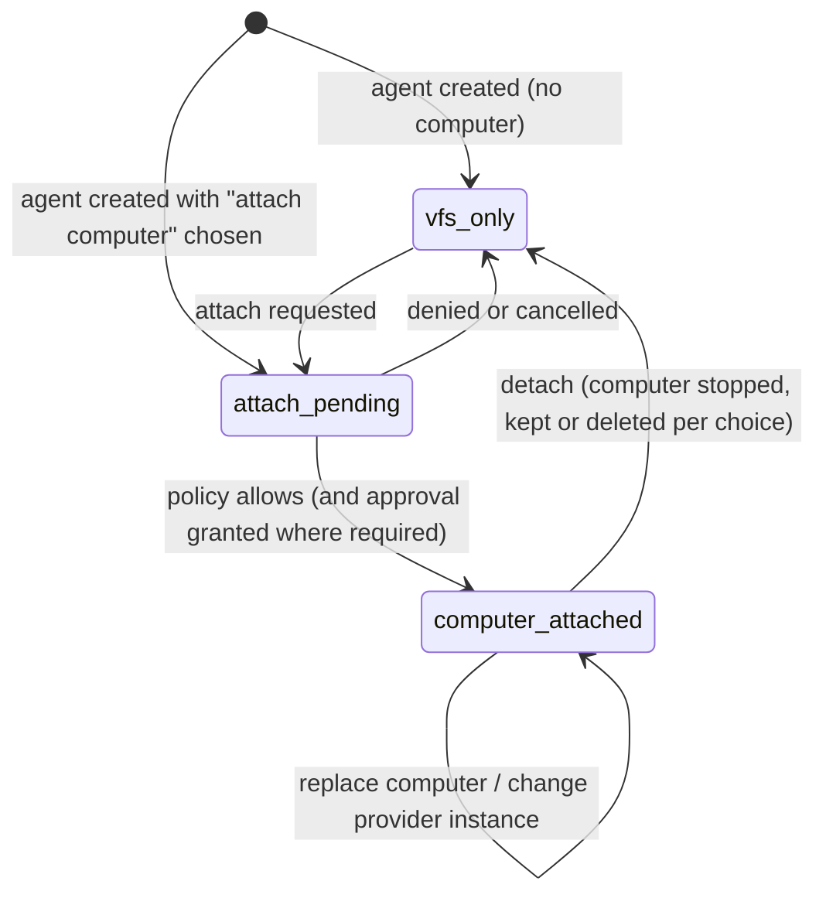
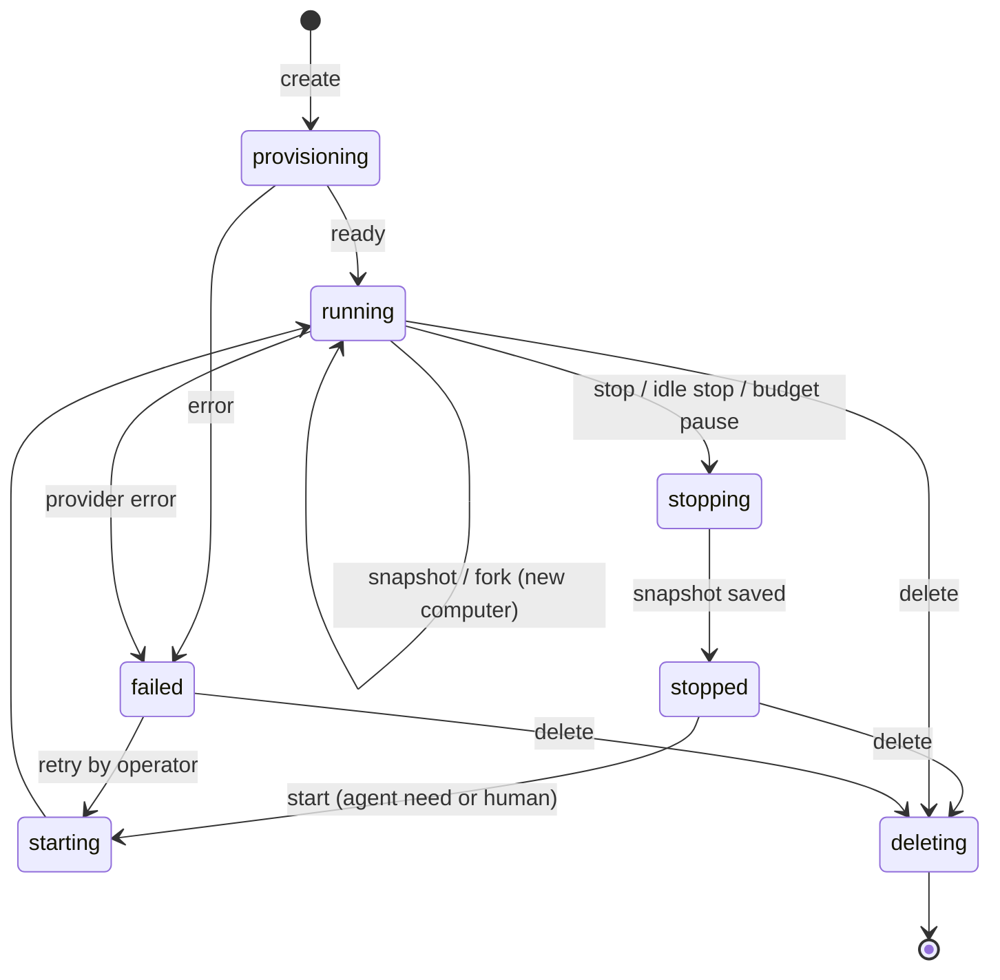
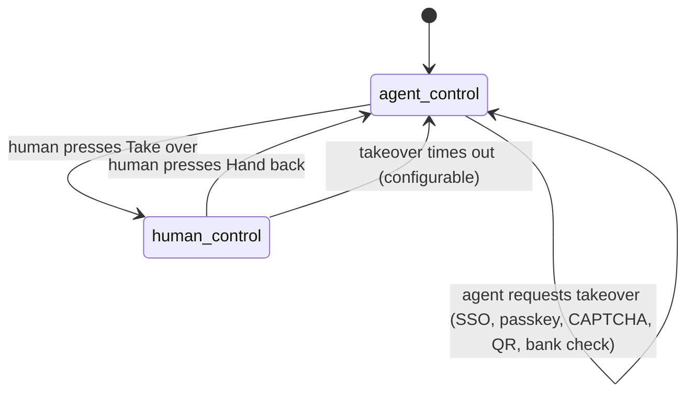

# Computer Provider Contract

Status: Design — planned (Phase 2). No implementation claims.
Verified: 2026-11-02 against docs/PRODUCT_DIRECTION.md; current-state statements checked against docs/CURRENT_STATE.md.
Owner doc: [Product Direction](../PRODUCT_DIRECTION.md).

This document defines how an OpenCompany agent gets, uses and loses an optional computer: the
`ComputerProvider` contract, lifecycle, isolation, credentials, egress, takeover, approvals, VFS
sync, and the **computerless mode** that must keep the product complete without one. Nothing here
exists in code today. [Current State](../CURRENT_STATE.md) lists "embedded Playwright browser
sessions with human takeover" as not current, and there is no per-agent compute.

Related designs:

- [Governance Model](governance-model.md): approvals, the hard-deny floor, budgets, the credential
  broker and audit that this contract relies on.
- [API-first client split](api-first-client-split.md): the realtime stream that carries the computer
  panel (pillar 4, API-first now).
- [Messenger UI](../planning/messenger-ui.md) and
  [UI structure and agent editing](../planning/ui-structure-and-agent-editing.md): the context pane
  that hosts the computer view, takeover controls and approval cards.
- [Agent-native work apps](../planning/agent-native-work-apps.md): the Tables, Issues and Docs data
  that reaches a computer only through the VFS.
- [OpenCompany Cloud](../planning/opencompany-cloud.md): managed computers on hosted Cloud.
- [Agent Primitives Catalog](../planning/agent-primitives-catalog.md) (pillar 6): the accepted spec
  for vault, secure forms, password manager connectors, takeover, live view, browser profiles, ports
  and the local computer. This contract implements the computer-side pieces and links rather than
  repeats that spec. Phasing follows the catalog's
  [Phasing](../planning/agent-primitives-catalog.md#phasing) section.
- [VFS Runtime Reference](../tools/vfs.md) and the
  [VFS agent-friendliness audit (2026-11)](vfs-agent-friendliness-audit-2026-11.md) (pillar 3): the
  governed data path that computers must go through.
- [Connections, Events and Routines](../planning/connections-events-routines.md) (pillar 9): deep
  connectors whose data reaches a computer only through the VFS, routines that may run on a
  computer, and the workspace event log that records every computer action.

## Goals and non-goals

Goals:

- One app-owned contract that every computer source implements, so the runtime, UI and governance
  layers never branch on a vendor.
- Per-agent isolation by default; sharing only as an explicit, warned opt-in.
- Credentials never enter the model context or the computer.
- Every consequential computer action passes the same server-side approval and audit path as every
  other tool.
- A product that is complete without any computer, and agents for which VFS-only is a deliberate,
  first-class configuration.
- **The computer is never a bypass of the VFS.** Company data reaches a computer only through the VFS
  and returns only through the VFS write path (see [the invariant](#vfs-invariant-the-computer-is-never-a-bypass)).

Non-goals:

- OpenCompany does not run a VM fleet. Compute always comes through a provider
  ([Product Direction, non-goals](../PRODUCT_DIRECTION.md#non-goals)).
- No browser embedded in the OpenCompany app. The browser lives on the agent's computer.
- No GUI-first execution. A computer is the fallback for work that structured tools cannot do, not
  the default path (see [execution preference](#execution-preference)).
- No remotely flippable egress or telemetry flags in self-hosted components.

## Relationship to the Bowerbird Workspace API v1alpha

The contract is shaped on Bowerbird's public Workspace API `v1alpha` (bwb-cloud decision 0011, and
the public [WorkspaceProvider contract](https://github.com/OpenCompanyApp/openfactory/blob/main/docs/planning/designs/execution/workspaces-debugging-and-sessions.md#the-workspaceprovider-contract)).
That API is an OpenAPI document plus a conformance suite covering create, list, inspect, start,
stop, resume, delete, fork, snapshot, files, exec, processes, wait and exposures. Nothing on the
Bowerbird side is built yet either.

**OpenCompany is the reference consumer and first design partner of `v1alpha`**
([OpenCompany × Bowerbird, computers](../planning/bowerbird-synergy.md#31-computers-opencompany-as-the-workspace-apis-reference-consumer)).
Its Bowerbird driver implements `v1alpha` directly, and OpenCompany runs the `v1alpha` conformance
suite and agent-experience suite against it. Real OpenCompany workloads (idle-heavy, stop/resume,
fork) are S1's first demand.

| `ComputerProvider` operation | Workspace API `v1alpha` / WorkspaceProvider | Notes |
|---|---|---|
| `create` | `create(image or template, …, request_id)` | Idempotent by request ID on both sides |
| `start` | `start` / `resume` | OpenCompany has one verb; a provider resumes from its last snapshot when one exists |
| `stop` | `stop` (final snapshot) | |
| `snapshot` | `snapshot(workspace, name?)` | |
| `fork` | `fork(snapshot, count, …)` | OpenCompany forks one at a time |
| `exec` | `exec(workspace, argv, limits)`, `processes`, `wait` | argv arrays, never a host shell |
| `files` | `read_files`, `put_files` | |
| `ports` | `expose` / `hide` | Exposure is approval-gated in OpenCompany |
| `screen` | `desktop_stream` | **Proposed by OpenCompany** for `v1alpha` as part of an optional capability; not yet in the API |
| `browser` | `browser` (proposed) | **Proposed by OpenCompany** for `v1alpha` as part of the same optional capability. Until accepted, drivers build it over `exec` plus a private exposure |
| `delete` | `delete` | |
| TTL | `set_ttl` | Used for the provider-side safety net, not for idle stop |

Consequence: the core operations (lifecycle, exec, files, ports) map directly, so a Bowerbird
provider implements them without translation. `browser`, `screen` and `desktop_stream` are
**OpenCompany's proposal to `v1alpha`** as one optional capability (Phase 2, with S1), not a
permanent OpenCompany-only extension. Until it is part of the API, and for providers that never
implement it, capability discovery, not provider identity, decides what the UI and tools offer.

OpenCompany never waits on Bowerbird. Local and boat providers ship first; the **Bowerbird driver
ships in Phase 2 alongside Bowerbird's S1**, when its sandboxes are live
([Product Direction, relationship to Bowerbird](../PRODUCT_DIRECTION.md#relationship-to-bowerbird)).

**Workload split.** OpenCompany owns business automation: routines, events, approvals, agent work and
the human surface. Bowerbird owns software delivery and heavy, durable pipelines. Within this contract
Bowerbird is a computer provider. It does not own OpenCompany's triggers, events or durable execution;
the earlier [Bowerbird durable automation integration](bowerbird-durable-automation-integration.md)
design is superseded. Heavy pipeline work graduates to Bowerbird
([routines on a computer](#routines-on-a-computer)) rather than running on agent computers.

## Concepts

| Term | Meaning |
|---|---|
| **Computer** | One isolated machine (container, microVM or VM) with a filesystem, processes, optionally a browser and a screen. Owned by exactly one workspace. |
| **Provider driver** | App-owned code that implements the contract for one kind of backend (Docker, Firecracker, boat, E2B, Daytona, Bowerbird, connected hosts via `oc host` or SSH). |
| **Provider instance** | A configured use of a driver: endpoint, region, credentials reference, defaults, limits. Declared in config or workspace settings, never in code. |
| **Agent computer mode** | Per agent: `vfs_only` (no computer) or `computer_attached`. A setting of the agent, not a different kind of agent. |
| **Attachment** | The link between a computer and the agent(s) allowed to use it. Default: exactly one agent. Created by attach, removed by detach. |
| **Control owner** | The single actor (the agent or one named human) that may send input at a given moment. |
| **Capability manifest** | What a provider instance can do, published by the driver and checked before any tool or UI is offered. |

## Per-agent attachment

Computer access is a per-agent choice ([Product Direction, pillar 2](../PRODUCT_DIRECTION.md#2-own-computer-per-agent-optional-strongly-recommended)).
Within one workspace some agents have a computer and others are VFS-only. VFS-only is a first-class,
supported configuration and the natural least-privilege choice for agents that only handle company
data (triage, reporting, bookkeeping). It is not a degraded mode.

The computer is therefore modelled as an **attachment to an agent**, not as a property of the
workspace or of an agent type:

Rules:

- **Who may attach** follows the preset
  ([Governance Model, computer access policy](governance-model.md#computer-access-policy)): in
  Personal the owner attaches; in Team admins decide which agents may have a computer; in Company a
  written computer-attach policy is the default (which agents, roles or templates, which providers,
  forbidden combinations), and attach can require approval. An agent can request a computer; it can
  never attach one to itself.
- **Mode switches preserve the agent.** Attaching or detaching keeps the agent's identity, identity
  files, memory, skills, schedules, tool grants, VFS permissions, budget and history unchanged. Only
  the computer tool group and the computer panel appear or disappear.
- **Detaching never deletes the agent.** The detach action offers: stop and keep the computer
  (re-attachable later), keep only snapshots, or delete the computer and its snapshots (approval-gated).
  Brokered browser profiles on that computer are revoked on delete.
- **Attachment changes take effect at a run boundary.** A run in progress keeps its tool list; the
  next run is built for the new mode. A detach during a run ends in-flight computer calls as
  `cancelled` or `ambiguous` through the run control plane.
- **Audited.** Attach, detach, replace and delete are audit events with the deciding human, the
  policy that allowed it and any approval.

## Contract operations

All operations are workspace-scoped, take an idempotency key for mutations, and return structured
errors with a stable code (`unsupported_capability`, `provider_unavailable`, `quota_exceeded`,
`not_found`, `conflict`, `timeout`, `ambiguous`). Provider credentials are resolved by the driver
from the credential broker and never appear in arguments, results or logs.

| Operation | Input | Result | Required? |
|---|---|---|---|
| `capabilities()` | provider instance | capability manifest | Required |
| `create(spec)` | image or template ref, size class, region, labels, idempotency key | computer handle, initial state | Required |
| `start(handle)` | handle | state `running` | Required |
| `stop(handle)` | handle, `snapshot: bool` | state `stopped` | Required |
| `snapshot(handle, name?)` | handle | snapshot ref, size | Optional (`snapshots`) |
| `fork(snapshot)` | snapshot ref, idempotency key | new computer handle | Optional (`fork`) |
| `exec(handle, argv, limits)` | argv array, cwd, env (non-secret), timeout, output cap, foreground/background | exit code, capped stdout/stderr, process id when background | Required |
| `processes(handle)` / `wait(handle, pid)` | handle | process list / exit | Optional (`background_exec`) |
| `files.read / list / write / delete` | path, bounded bytes | content or listing | Required |
| `browser.open / navigate / snapshot / act / close` | session, URL or accessibility-tree action | page state, accessibility tree, screenshot ref | Optional (`browser`) |
| `screen.stream(handle)` | handle, viewer identity | short-lived, private stream descriptor | Optional (`screen_stream`) |
| `screen.input(handle, events)` | input events from the control owner | ack | Optional (`screen_input`) |
| `ports.expose / hide / list` | port, visibility (`private` default) | private URL | Optional (`ports`) |
| `delete(handle)` | handle, retention policy | — | Required |

Rules:

- **Bounded output.** Every `exec`, file and browser result has byte, line and time caps, mirroring
  VFS budgets. Large results spill into the agent's VFS `/files` path instead of the context.
- **At-most-once mutations.** Every mutating operation runs through the existing
  `agent_tool_executions` claim (see [Agent Run Queue Control Plane](agent-run-queue-control-plane.md)).
  A call that may have reached the provider becomes `ambiguous` and is never retried automatically.
- **No host shell.** `exec` takes an argv array executed inside the guest. Drivers must never pass
  agent input to a shell on the OpenCompany host or the provider host.

## Capability discovery

Each provider instance publishes a manifest. The runtime matches it against what a tool or UI
element needs and hides what is missing, rather than failing at call time.

| Field | Example values |
|---|---|
| `operations` | `exec`, `files`, `snapshots`, `fork`, `background_exec`, `browser`, `screen_stream`, `screen_input`, `ports` |
| `isolation_class` | `container`, `microvm`, `vm`, `self_managed_host` (with the host's sandbox mode: `container`, `bwrap` or `none`) |
| `crosses_trust_boundary` | `true` for any third-party or remote host |
| `fork_kind` / `restore_kind` | `copy_on_write` or `copied` / `lazy` or `full` |
| `idle_detection` | `provider` or `opencompany` (who measures idleness) |
| `egress_control` | `enforced` (provider or proxy enforces allowlist), `advisory`, `none` |
| `regions` | provider-declared list |
| `size_classes` | provider-declared list |
| `metering` | `per_second`, `per_minute`, `none` |

A provider instance with `egress_control: none` may be registered, but the UI labels it, and
workspace policy can forbid attaching it to agents that hold external-write grants.

## Lifecycle

- **Lazy start.** A run that needs a computer starts it on first computer-tool call, not at run
  start. Chat-only turns never wake a computer.
- **Idle stop.** OpenCompany owns idle detection and does not rely on the provider. (boat, for
  example, documents a TTL counted from creation and "no idle timer".) A computer is idle when no
  run holds it, no human holds control, no exposed port has recent traffic and no background
  process is marked long-running. After a configurable idle window it is stopped with a snapshot.
  Long-running processes must be declared by the agent and are approval-gated beyond a workspace
  limit.
- **Provider TTL as safety net.** Where supported, OpenCompany also sets a provider-side TTL longer
  than the idle window, so a lost control plane cannot leave a computer running indefinitely.
- **Snapshots.** Named snapshots belong to the workspace and the computer. Retention and count
  limits come from workspace policy. Snapshots are never shared across workspaces.
- **Fork.** A fork produces a new computer with its own attachment. It does not inherit the parent's
  control owner, exposures, or brokered sessions.
- **Budget pause.** When a compute budget is exhausted, the run pauses (see
  [Governance Model, budgets](governance-model.md#budgets)) and the computer goes through the normal
  stop path.
- **State is durable.** Computer records (workspace, provider instance, external handle, state,
  attachment, last activity, snapshots) are database rows, reconciled periodically against the provider
  in the same style as `agent-runs:reconcile`.

## Isolation and sharing

- **One computer per agent by default.** Files, processes, browser profiles, cookies and downloads of
  one agent are invisible to every other agent.
- **Never across workspaces.** A computer, its snapshots and its browser profiles belong to one
  workspace. No provider instance may reuse a disk or snapshot across workspaces.
- **Shared team computer: explicit opt-in only.** An admin can attach one computer to several agents.
  Enabling it shows a warning that states, in plain language, that agents on a shared computer can
  read each other's files, sessions and logins, and that agents are not a security boundary from each
  other on that machine. The choice is recorded in the audit log with the admin's identity. Shared
  computers are labelled in every UI that shows them.
- **Concurrency on a shared computer.** Per-agent run serialization still applies. Concurrent runs of
  different agents on one shared computer are allowed only if the workspace policy enables it.
- **Shared company data never travels via disk.** Agents share work through governed OpenCompany
  resources (VFS, Tables, Issues, Docs, Files), not through ambient disk access on a common machine.

## Providers and registration

Provider order from the [Product Direction](../PRODUCT_DIRECTION.md#2-own-computer-per-agent-optional-strongly-recommended):

| Order | Driver | Typical isolation | Trust boundary | Notes |
|---|---|---|---|---|
| 1 | Local Docker or Firecracker on the self-hosted machine | container / microVM | Stays in the installation | Self-host default. Docker gives container isolation only and must be labelled as such. |
| 2 | boat | VM | Crosses (third party, EU regions) | First hosted partner. A self-hoster uses their own boat account. |
| 3 | E2B, Daytona | provider-specific | Crosses | |
| 4 | Bowerbird agent sandboxes | microVM | Crosses | Driver in Phase 2 alongside Bowerbird's S1; direct `v1alpha` implementation. **Hosted Cloud's default** once S1 passes its gate; boat remains a provider |
| 5 | **Connected hosts** (bring your own machine: Raspberry Pi, home server, laptop, VPS, office machine) via the outbound `oc host` daemon, or SSH-only hosts | Host sandbox mode; labelled **self-managed** | Stays with the customer's machine, but isolation is not guaranteed by OpenCompany | See [Connected hosts](#connected-hosts). Also the route for the catalog's "connect a local computer" primitive |

Registration rules (per AGENTS.md "avoid hardcoding provider IDs, URLs, capabilities"):

- **Drivers are code; instances are config.** A driver registers under a driver key. Provider
  instances, endpoints, regions, size classes, default images, limits and enablement live in a
  config file (proposed `config/computers.php`) and in workspace settings, with secrets resolved via
  the credential broker. No provider ID, URL, region or price appears in application code outside
  that config and its catalog.
- **Self-host defaults.** A fresh installation has no provider enabled until an operator enables
  one. Local Docker is the documented first choice.
- **Trust-boundary disclosure.** Enabling any instance with `crosses_trust_boundary: true` requires
  an admin confirmation that names the provider and states that the computer's files and outputs leave
  the installation. Data never fails over silently to a third-party provider; a capacity or outage
  problem surfaces as an error, not as a different provider.
- **Per-workspace choice.** A workspace chooses which enabled instances its agents may use and which
  is the default for new agents.
- **Provider picker with live prices.** Admin → Computers may show live, dated provider prices from
  Roost's public data (boat, E2B, Daytona, Bowerbird) when someone picks a provider. Roost stays
  neutral: losing comparisons are shown, and Bowerbird is listed only where it sells. Prices are read
  at runtime from that source, never hardcoded.
- **"Managed computer, powered by Bowerbird."** When an agent gets a computer, the picker may offer a
  managed Bowerbird computer as one option. It is an offer, never a default on self-host and never a
  requirement: self-hosted OpenCompany never needs a Bowerbird account.

## Connected hosts

Connected hosts are the bring-your-own-machine provider
([pillar 2, provider 5](../PRODUCT_DIRECTION.md#2-own-computer-per-agent-optional-strongly-recommended);
full design in [`oc` CLI and hosts](../planning/oc-cli-and-hosts.md#1-connected-hosts-bring-your-own-machine)).
The host side is the same Rust `oc` binary as the CLI ([pillar 10](../PRODUCT_DIRECTION.md#10-the-oc-cli-rust-agent-first)).

### Outbound-only protocol (design level)

No inbound ports are needed on the host; it works behind NAT and CGNAT, against self-hosted servers
and Cloud.

1. **Enrollment.** `oc host up --name <name>` runs device-flow login as a human with permission to
   add hosts, registers the host to one workspace, and receives a **host token**: a token type of its
   own, scoped to that host and workspace, unable to act as a user. It is stored in the OS keychain or
   a root-only file. The host appears as *pending* in Admin → Hosts until approved.
2. **Outbound connection.** The daemon (`oc host install-service` sets up systemd, launchd or a
   Windows service) keeps a long-lived outbound WebSocket or HTTP/2 connection to a **host gateway**
   on the server. All calls flow over that connection; the server never dials the host.
3. **Capability advertisement.** On connect the daemon advertises what it can offer: sandbox mode,
   OS and architecture (including Raspberry Pi aarch64), resources, whether a browser is installed,
   local MCP servers and event sources. The server turns this into the host's capability manifest
   ([capability discovery](#capability-discovery)); it only describes, it never grants.
4. **Calls.** `exec`, files, processes, ports, browser, MCP and mount operations are framed requests
   over the connection, each tied to a run, agent and on-behalf-of human, with limits.
5. **Per-call secret injection.** When a call needs a credential, the broker sends it with that call
   only (or, preferably, keeps it server-side and proxies). Secrets are never synced or stored on the
   host.
6. **Heartbeat and presence.** Regular heartbeats report online/offline state and resource use. An
   offline host is a clear `provider_unavailable` tool error, never a hang.
7. **Rotation.** Host tokens rotate automatically over the live connection; a host offline past the
   rotation window must re-enroll.
8. **Revocation.** Admin → Hosts → Disconnect (the kill switch) revokes the token, closes the
   connection and makes the daemon stop all agent processes it started.

### Sandbox modes

| Mode | Behavior |
|---|---|
| `container` (default) | Agent work runs in Podman or Docker on the host |
| `bwrap` | bubblewrap on Linux (Phase 3) |
| `none` | Only with an explicit flag (`--i-understand-no-isolation`); shown in red in Admin |

Allowed paths, CPU, memory and time limits and a local egress allowlist are enforced by the daemon on
a **best-effort** basis.

### Capabilities, granted per agent

| Capability | Contract mapping | Phase |
|---|---|---|
| **Computer** | `exec`, files, processes, ports, and `browser` if installed; snapshots and fork only if the sandbox mode supports them | 2 |
| **Local MCP bridge** | stdio MCP servers on the host exposed as an MCP connection. This is the supported home for stdio MCP; it never runs in the web process | 3 |
| **VFS projection** | `oc mount` (FUSE) or sync of the agent's governed VFS view, writes back through VFS policy ([VFS invariant](#vfs-invariant-the-computer-is-never-a-bypass)) | 3 (mount) |
| **Event source** | File watchers, sensors, webhook relays and device cron emitted into the event log as **untrusted** events | 3 |
| **ACP runner** | Coding-agent CLIs over ACP using the user's own subscriptions ([ACP runner](#acp-runner-coding-agent-clis)) | 2 |

- **Default: one agent per host gets the computer capability,** mirroring one computer per agent. MCP
  bridges may be granted to several agents. Sharing the computer capability follows the shared-computer
  opt-in and warning.
- A host belongs to exactly one workspace and is never shared across workspaces.
- A host can be an agent's computer, or a second machine next to its provider computer.

### SSH-only hosts

For machines without `oc`, an **SSH host** connection reaches a tailnet address or any direct address
using a key from the vault (injected per call by the broker), or Tailscale SSH where the server is on
the tailnet. SSH hosts get exec, files and the computer capability only: no MCP bridge, no event
source, no daemon-side sandbox or limits. They are labelled self-managed, like `oc` hosts.

### Tailscale

- Tailscale is a supported network path, not a requirement.
- A **self-hosted** OpenCompany server may run a Tailscale **sidecar** so it reaches SSH hosts (and
  `oc` hosts reach it) over MagicDNS names with nothing exposed publicly.
- **Hosted Cloud never joins a customer's tailnet.** On Cloud, hosts connect only through the outbound
  `oc host` connection.

### Self-managed labelling

A connected host is labelled **self-managed** everywhere it is shown (Admin → Hosts, agent profile,
rail badge, approval cards). OpenCompany does **not** guarantee for it:

- isolation between the agent's work and the rest of the machine (especially in `none` mode);
- that other users or software on the host cannot read files, processes or browser sessions;
- egress enforcement beyond the daemon's best effort;
- snapshots, fork, idle stop or retention;
- physical security, patching or availability.

What it **does** guarantee is unchanged: policy, approvals, the floor, on-behalf-of access, per-call
secrets and audit all apply to host actions exactly as to provider computers, and company data
reaches the host only through the VFS projection.

## Execution preference

A computer is powerful and expensive. The runtime and prompts prefer, in order:

1. Internal OpenCompany tools, VFS and mruby Code Mode.
2. Connection tools: deep connectors, MCP and API manifests.
3. Search and fetch adapters.
4. Shell on the computer.
5. Browser automation on the computer (accessibility-tree first).
6. Visual computer use (pixels and input events) when semantic browser control is insufficient.
7. Human takeover for authentication or ambiguous, high-impact interaction.

## Browser and screen

- **Browser sessions** run inside the computer. The agent drives them through accessibility-tree
  actions by default; arbitrary page JavaScript execution is a separate, more privileged capability.
- **Profiles** (catalog: persistent browser profile, Phase 2) are per agent and per computer, never
  shared across agents by default. Persistent logged-in profiles are opt-in and listed in
  the agent's profile with a revoke action.
- **Screen stream** is private, short-lived, bound to the viewer's identity and workspace, and served
  from an origin separate from the OpenCompany app origin. Stream URLs never enter model context,
  chat history or logs.
- **Redaction.** Recorded action logs redact typed values in password fields, cookies, headers,
  storage and payment data.

## Takeover viewer

In the three-pane layout (rail | main | context pane), the **context pane** shows the agent's
computer **only for agents that have one** ([pillar 4](../PRODUCT_DIRECTION.md#4-messenger-first-and-api-first)):
the terminal, browser or screen live, with **watch, take over and hand back** (catalog: live view and
work log, takeover and hand back; both Phase 2). "Computer panel" in this document means that view of
the context pane. Watching is not controlling: view and control are separate permissions. The rail
marks computer agents with 🖥; takeover and sign-in requests also surface on Home under "needs you".

Semantics:

- **Exactly one control owner** at any time. Take over is allowed for humans with the
  `computer.takeover` capability on that agent (see [Governance Model](governance-model.md#roles-and-principals)).
- **Take over pauses the agent's computer actions.** The run stays alive but its computer tool calls
  block with a "human in control" result until hand back. Non-computer work may continue.
- **Agent-requested takeover.** When an agent reaches something only a human can do (SSO, passkey,
  CAPTCHA, cross-device approval, QR code, bank verification), it requests takeover with a reason.
  For a plain password or one-time code it first uses the secret lookup order below. The request appears as a card in the conversation and as a push
  notification. The agent never asks for the secret in chat.
- **Hand back** ("I'm done") resumes the agent with a short, factual note of what the human did (for example
  "human completed sign-in on example.com"). Typed content is never reported back.
- **Audit.** Every take over and hand back is an event in the workspace event log with the human's identity and time span.
  Actions taken during human control are attributed to the human, not the agent.
- **Session persistence.** A sign-in completed during takeover persists in the agent's browser
  profile.
- **Mobile and Telegram.** The takeover screen must work on mobile web; Telegram opens it through the
  Mini App. Latency over mobile is a catalog open question.

## Credential broker

Credentials never enter the model or the computer (browser sign-in sessions are the one explicit
exception, below).

- **Who owns them.** Connection secrets (from the generic OAuth broker or entered by admins), MCP OAuth
  tokens, API-manifest keys and provider API keys live in the per-workspace vault, which is part of
  the Connections model ([Connections, Events and Routines](../planning/connections-events-routines.md#1-connections)).
  The credential broker is the only component that decrypts them for outbound use. Connection secrets
  are never handed to a computer; a computer agent uses a connection through server-side tools or
  the VFS projection.
- **Injection at the boundary.** When a tool or a request from the computer needs a credential, the
  broker adds it at the network or tool boundary:
  - **Tool boundary:** server-side tools (connections, MCP, API manifests) are called by OpenCompany, which
    attaches the credential. The model sees only the result.
  - **Network boundary:** the computer's outbound traffic to allowlisted API hosts goes through an
    egress proxy that attaches headers for matching destinations, so a program on the computer can
    call an API without ever holding the key.
- **Surrogates only.** If a program on the computer needs an identifier for a credential, it gets a
  run-scoped surrogate token that is meaningless outside the proxy and expires with the run.
- **Never in the guest.** No credential is written to the computer's environment, disk, browser
  storage or command line. Drivers that cannot support a proxy cannot receive brokered API
  credentials; their agents fall back to server-side tools for those connections.
- **Secret lookup order for the browser** (catalog: vault, secure form, password manager
  connectors). When a page needs a login or card, the fill component resolves the value through the
  `SecretSource` order **vault → connected password manager → secure form**: a per-workspace vault
  entry granted to this agent (Phase 2); a connected password manager such as 1Password, then
  Bitwarden/Vaultwarden, with human approval before a fill (Phase 3); otherwise a secure-form card
  where a human enters the value (Phase 2, Mini App on Telegram). The agent knows which entries
  exist, never their values.
- **Browser fill boundary.** A filled value enters the page only through the fill component at the
  moment of use. It is never placed in model context, the VFS, Code Mode globals, logs, the
  computer's disk, environment or command line. One-time codes read from the agent's inbox (the Mail app, Phase 2)
  follow the same path and are redacted from model context where possible.
- **Sessions are the residue.** The resulting session cookie lives in the agent's browser profile on
  its computer. That is why profiles are per agent, opt-in, revocable and never shared without the
  explicit shared-computer opt-in.
- **VFS-only agents** use the same broker through connection tools and MCP, without a browser
  (catalog design rule "both agent modes").

The broker is shared with the governance layer; see
[Governance Model, credential broker](governance-model.md#connections-oauth-and-the-credential-broker).

## Egress allowlist

- **Two egress profiles: deny-all and standard.** The workspace chooses the egress profile per
  agent (a network setting, unrelated to the deleted behaviour modes). The standard allowlist covers package
  registries and the OS mirror for the computer's image; everything else is added explicitly.
- **Enforcement point.** Where the provider supports it, egress is enforced by the provider or an
  OpenCompany-controlled proxy in front of the computer. Where it does not, the manifest says
  `advisory` or `none`, and the UI labels the agent accordingly.
- **Every allowlisted domain is an attack surface.** Adding a domain that accepts arbitrary uploads
  (file hosts, paste sites, generic object storage, AI APIs that accept attacker keys) is flagged and
  approval-gated.
- **Changes are governed.** Adding a domain requires an approver; agents can request additions, never
  grant them. Changes are audited.
- **Brokered traffic** follows the same allowlist. Credentials are attached only for destinations that
  are both allowlisted and mapped to that credential.

## Approvals for computer actions

Computer tools go through the same policy engine and approval card contract as every other tool
([Governance Model](governance-model.md#action-classes-and-default-gates)). Gating is **by
reversibility class**, with defaults from the workspace preset (Personal, Team, Company); invariants,
the floor and explicit grants always win. Computer actions map to classes as follows:

| Computer action | Class | Personal | Team | Company |
|---|---|---|---|---|
| Create, start, stop own computer; read files; screenshots; browse and read allowlisted pages | `read` / sandbox control | Allowed | Allowed | Allowed |
| `exec`, file writes and software installs inside the agent's own computer (effects stay in the sandbox; a snapshot makes them revertible) | sandbox-local, treated as `reversible_edit` | Auto-apply, visible in activity | Auto-apply | Auto-apply unless the Space or computer policy requires proposals |
| Browser drafts (filling a form without submitting, saving a draft) | `external_draft` | Auto-apply | Auto-apply | Auto-apply |
| Browser form submission, sending, posting; outbound calls that change external state | `external_send` | Ask first time per target, then "always for this recipient or domain" | Same; manager approves | Same; routine-started runs only to allowlisted targets |
| Purchases, card use | `spend` | Ask or per-agent cap | Budget per agent | Budget plus two approvers above threshold |
| Expose a port; add an egress domain; enable a persistent browser profile; share a computer | `exposure_widening` | Ask | Admin | Admin plus second approver |
| Stop and keep, detach and keep | reversible | Allowed for the deciding human | Same | Same |
| Delete a computer or its snapshots | `delete` (no 30-day trash for disks: deletion is treated as purge) | Owner approves | Approval | Two approvers |
| Move money between accounts; change passwords, 2FA or recovery settings | `floor` | **Never** | **Never** | **Never** |

Ports are always time-limited and authenticated by default (catalog: ports and preview links).

Additional rules:

- **On-behalf-of applies to computer runs.** A computer run acts for the same human as any other run
  (requester, routine owner or least-privileged group-chat invoker). What it may pull through the VFS
  projection, which connections it may use through the broker and which external targets it may reach
  are intersected with that human's access.
- **Triggers are not consent.** A run started by a schedule, webhook or inbound message can use the
  computer, but its external actions always ask, even with an "always" exception.
- **Taint.** A run whose computer browser or files ingested untrusted content loses automatic approval
  for external actions for the rest of the run. Sandbox-local work continues under the preset.
- **Read-only runs** (heartbeats, background research) receive no computer write tools at all, and by
  default no computer tools.
- **Floor phasing.** Phase 2 ships the money-movement and password-change hard-deny entries with the
  first browser ([Product Direction, phases](../PRODUCT_DIRECTION.md#phases)); the full floor, scoped
  exceptions on cards and non-blocking approvals follow in Phase 3. Until Phase 3, approvals are
  answered under the interim Phase 1 authority (workspace admins or the human who started the
  conversation, never the requesting agent).
- **Basic compute cap.** Phase 2 also ships a basic compute cap: at the cap, computers stop and
  computer work pauses ([Governance Model, budgets](governance-model.md#budgets)).
- **Human control is not an approval.** Actions a human performs during takeover are the human's own
  actions, attributed to them; they do not create standing grants for the agent.

## VFS projection (mount and sync)

The VFS is the governed path to company data: tables, issues, docs, files and deep-connector content
such as a Google Drive mount ([pillar 3](../PRODUCT_DIRECTION.md#3-the-vfs-is-the-governed-path-to-company-data)).
"VFS projection" is the Phase 2 name for making it available on a computer. Its role depends on the
agent's mode:

- **VFS-only agents:** the VFS is a complete fallback workspace. Real file-style work (read, search,
  transform, write, archive, patch records) happens through it and mruby Code Mode alone.
- **Agents with a computer:** the VFS and the computer stay available together and work together.
  The VFS remains the permission- and governance-controlled path to company data.

### VFS invariant: the computer is never a bypass

> **Invariant.** Company data reaches a computer only through the VFS, and changes to company data
> flow back only through the VFS write path. Workspace scoping, resource permissions, write policy,
> approvals and audit apply to every such read and write, exactly as for a direct VFS call by the same
> agent. No driver, image, credential, network route or API on the computer may read or write
> company data any other way.

Consequences:

- **Deep-connector data only through the VFS.** Drive, OneDrive and other storage mounts, mailboxes
  and MCP resources reach a computer only via the VFS projection, with effective access = external
  ACL ∩ OpenCompany grants. A computer agent never signs into the provider (for example Google Drive)
  with its own browser or CLI login to reach company data, and connection secrets never reach the
  computer.
- **Connected hosts** follow the same invariant: `oc mount` and sync are VFS projections, and a host's
  own files are not company data until pushed through the VFS write path.
- **No direct data credentials on the computer.** The computer never holds database credentials,
  storage keys, OpenCompany session tokens or an unscoped API token. Egress to OpenCompany's own data
  APIs is blocked except through the VFS bridge.
- **Three sanctioned bridges, one policy.** All three call the same server-side VFS services:
  1. **Sync** (Phase 2 default): `computer_pull(vfs_path, dest)` copies a permitted VFS subtree into a
     fixed directory on the computer (proposed `/company`); `computer_push(src, vfs_path)` writes back
     through `vfs_write` / `vfs_patch`.
  2. **CLI bridge:** a VFS command-line client on the computer that talks to OpenCompany with a
     run-scoped, agent-bound surrogate token issued by the credential broker. It can do only what
     `vfs_exec` / `vfs_patch` / `vfs_write` would allow that agent in that run, and every call is a
     normal `vfs.*` event in the workspace event log.
  3. **Mount** (later): a live mount whose every path operation is checked server-side, not in the
     guest.
- **Read rules.** Data the agent cannot read through the VFS is never synced, bridged or mounted.
  Pagination, budgets and capability metadata apply unchanged. A shared team computer receives only
  data visible to every agent attached to it.
- **Write rules.** Pulled data is a snapshot, not a live copy. Writing it back is an explicit push or
  bridge call that goes through VFS mutation rules: required tool permissions, patch eligibility,
  approval creation and approved replay with permission recheck.
- **Audit and provenance.** Every bridged read and write is recorded as a `vfs.*` event in the workspace event log with
  agent, run, computer and bridge identifiers, so "who changed this record, from where" has the same
  answer whether the change came from a VFS tool, Code Mode or a computer.
- **Taint flows through.** Content that came from untrusted sources on the computer (web pages,
  downloads) and is pushed into the VFS carries the run's taint for approval purposes.

## Workspace scoping and audit

- Computer, snapshot, attachment, egress list, profile and exposure records all carry
  `workspace_id` and are read through `forWorkspace()` (or through their parent relation).
- Queue adapters and reconcilers bind the workspace before touching a computer and fail closed if it
  is missing, as the run control plane does today.
- Every attach, detach, lifecycle change, exec, file write, browser action, exposure, takeover and
  hand back is an event in the workspace event log
  ([envelope](../planning/connections-events-routines.md#2-events)), with the causality chain of the
  run, routine or human that caused it. That log powers audit, replay, the activity feed and budget
  accounting; there is no separate computer audit table.
- Compute usage (running seconds, stopped snapshot storage, exposure time) is recorded as usage events
  per computer and per agent and counts against the basic compute cap (Phase 2) and budgets
  (Phase 3).

## Tool registration

- Tool registration follows the **agent's mode**. A `vfs_only` agent gets no computer tools. A
  `computer_attached` agent gets the computer tool group (proposed `computer_*`) in addition to, never
  instead of, its VFS and Code Mode tools.
- The computer tool provider registers a tool **only** when the agent is `computer_attached`, the
  attached provider instance's manifest includes the needed operation, and the agent's grants and
  run mode permit it.
- Browser and screen tools are registered only when the manifest declares `browser` or
  `screen_stream`.
- Tool schemas stay byte-stable within a run for prompt-cache stability; capability changes take
  effect on the next run, not mid-run.
- The system prompt states briefly whether the agent has a computer and what it can do. An agent
  without one is never told to "use your computer".

## Routines on a computer

Routines ([Connections, Events and Routines](../planning/connections-events-routines.md#4-routines))
run as normal runs on the agent-run control plane. For a computer agent, a routine may use its
computer:

- An **agent** or **hybrid** routine owned by a `computer_attached` agent gets the computer tool group
  like any act-mode run of that agent; a read-only routine (heartbeat, monitor) gets no computer write
  tools and by default no computer tools.
- A **script** routine runs in mruby by default; skill scripts may run on the agent's computer, never
  in the web process. MCP stdio servers likewise run only on an agent's computer or a sidecar.
- Trigger-started routines follow "a trigger is never consent": gated computer actions produce
  approval cards.
- The computer starts lazily when the routine first needs it, and idle stop applies afterwards. The
  routine's budget includes compute.
- **Heavy pipelines graduate to Bowerbird.** A script routine that becomes heavy (long-running, needing
  reproducibility and evidence, CI-like builds) graduates to a Bowerbird pipeline with the same mruby
  dialect, rather than running on an agent computer. OpenCompany keeps the trigger, approvals and
  human context; Bowerbird returns events, receipts and evidence
  ([One Ruby](../planning/bowerbird-synergy.md#32-one-ruby-from-routine-to-pipeline); Phases 3–4).
- Detaching the computer makes the routine's computer steps fail with `unsupported_capability`; the
  routine is flagged for its owner, not silently rewritten.

## ACP runner (coding-agent CLIs)

One route for agent delegation ([pillar 9, agent connections](../PRODUCT_DIRECTION.md#9-connections-events-and-routines)) runs on the agent's own computer
or a connected host (Phase 2):

- **What it runs.** Coding-agent CLIs driven over **ACP** (Agent Client Protocol): Claude Code, Codex
  CLI, Gemini/Antigravity CLI, Grok Build, OpenCode and Goose, using the **user's own subscriptions**.
  It implements the `ExternalAgentProvider` contract (launch, follow up, stop, status and events,
  results), so the messenger run card and governance are the same as for hosted cloud agents.
- **Credentials via the broker.** CLI logins and API keys are the user's own, held in the vault and
  injected per call or proxied by the broker; they are not written to the computer's disk or the
  CLI's config in plain form. Where a CLI insists on a local credential file, the runner creates it
  only for the session in the sandbox and removes it afterwards, and the provider is labelled as such.
- **Egress allowlist** applies: the CLI reaches only its provider's API and other allowlisted hosts.
- **VFS projection** is the only path to company data; the CLI works on a pulled or mounted VFS view
  and a repository checkout granted to that agent, and writes come back as change sets or PRs.
- **Approvals and audit** apply: launching is `agent_delegation` (ask first time per provider and
  repository), the CLI's tool calls run inside the computer under its sandbox, and its outputs are
  untrusted content. Every launch, follow-up, stop and result is an event.
- **Not for heavy pipelines.** Long CI-like work graduates to Bowerbird, and managed coding agents in
  Bowerbird sandboxes (Bowerbird Agents) are a separate, later provider.

## Publishing static builds as artifacts

Computer agents can use real frameworks (Vite, React, Svelte and so on) to build interactive
artifacts ([Artifacts and Forms, built on a computer](../planning/artifacts-and-forms.md#built-on-a-computer)):

- **Bundle upload, not live hosting.** The agent builds on its computer and uploads only the **static
  build output** as artifact assets (a `computer_publish_artifact`-style tool reading a build
  directory). The artifact is served from the user-content origin like any other interactive
  artifact, not from the computer.
- **No exposed app server.** A dev server on the computer is a preview mode only, shown through the
  context pane or a private, authenticated, time-limited port exposure (`exposure_widening`). It is
  never the publishing path, and stopping the computer never takes a published artifact down.
- **Server logic stays in mruby endpoints.** Bundles contain no server code that OpenCompany runs;
  generated JavaScript never runs on the server.
- **Same governance.** The upload creates a new immutable artifact version owned by the agent's
  on-behalf-of human; the publishing ladder applies (signed and public levels are
  `exposure_widening`). Bundles are size-capped and scanned before publish.
- **VFS-only agents** produce Pages and interactive artifacts without a build step; the computer only
  adds framework builds.

## API and realtime (pillar 4)

The API-first rule applies now ([pillar 4](../PRODUCT_DIRECTION.md#4-messenger-first-and-api-first)):
Inertia is frozen, and every computer surface is built on the versioned public API (see the
[API-first client split](api-first-client-split.md)):

- Versioned API endpoints for computer CRUD, attach/detach, lifecycle, snapshots, egress lists,
  profiles, sharing, takeover and hand back. No Inertia pages or page props.
- The realtime event stream carries computer state changes, the action timeline, takeover requests
  and approval requests for the computer panel. The screen stream itself is a separate media channel
  whose short-lived descriptor is fetched via the API.
- Push notifications for takeover requests and computer-related approvals.

## Computerless mode (VFS-only agents)

**OpenCompany must work fully without a computer.** This is a product requirement, not a fallback.
It applies at two levels: a whole installation with no provider configured, and individual
`vfs_only` agents in a workspace where other agents do have computers.

### What a computerless agent has

Everything except the computer: chat and group chats, assignment, Issues, Docs, Tables, Files
(including deep-connector mounts such as Google Drive), memory, the VFS shell, mruby Code Mode,
connections (deep connectors, MCP, API manifests), web search and fetch, routines, Telegram,
approvals, budgets and audit. The VFS is its complete workspace for file-style
work, under the same policy that governs a computer's access to company data.

### VFS-only as a deliberate choice

- VFS-only is a first-class configuration and the least-privilege option. Workspace policy may make it
  the default for new agents or for specific roles (see
  [Governance Model](governance-model.md#computer-access-policy)).
- The UI presents it as a valid choice ("this agent only works with company data") alongside the
  recommendation to attach a computer, never as an error state or a missing setup step.
- An agent in a mixed workspace is unaffected by other agents' computers: its tools, prompt and
  permissions do not change because a provider is configured for someone else.

### Requirements

- **No provider is required to install, boot, onboard or use OpenCompany.** A fresh self-host with no
  sandbox infrastructure is a complete product.
- **Clean tool degradation.** For a `vfs_only` agent, the computer tool provider registers nothing.
  The agent never sees a computer tool it cannot use, never gets "provider unavailable" errors for
  tools it did not need, and its tool list is identical to the pre-Phase-2 list.
- **Capability-driven, not provider-driven.** A computer with only `exec` and `files` gets shell and
  file tools but no browser tools. Missing capabilities are hidden, not stubbed.
- **Provider outage is not a product outage.** If the bound provider is unreachable, computer tools
  return a structured `provider_unavailable` result; the run continues with other tools and the UI
  shows the computer as unavailable. No chat, task, approval or automation path depends on a provider
  being up.
- **The UI recommends, never blocks.** Onboarding, agent creation and the agent profile recommend
  attaching a computer and explain what it adds (shell, real browser, installed software, logins,
  long-running work). Declining is one click and is remembered. No page, flow or feature is disabled
  because an agent lacks a computer; the computer panel simply is not shown.
- **Honest prompts.** The system prompt for a computerless agent describes its real capabilities.
  When a task genuinely needs a computer, the agent says so and suggests attaching one, rather than
  pretending or failing silently.
- **Routines and Code Mode unaffected.** Agent, script and hybrid routines, mruby Code Mode and VFS
  operations never require a computer.
- **Tests.** The focused suite runs with no computer provider configured and asserts that tool
  registration, agent construction and chat responses are unchanged.

### Detaching

Detaching returns the agent to `vfs_only` on the next run with identity, memory, grants and VFS
access unchanged (see [per-agent attachment](#per-agent-attachment)). In-flight computer tool calls
end as `ambiguous` or `cancelled` through the normal run control plane.

## Failure behavior

| Failure | Behavior |
|---|---|
| Provider create/start fails | Structured error to the run; computer marked `failed`; no silent switch to another provider |
| Provider call times out after sending | `ambiguous` in `agent_tool_executions`; not retried automatically |
| Control plane loses a computer | Reconciler compares provider state; orphaned running computers are stopped |
| Budget exhausted mid-run | Run paused, computer stopped with snapshot, approver notified |
| Egress proxy unavailable | Outbound traffic from the computer is blocked (fail closed), not opened |
| Takeover viewer disconnects | Control returns to the agent after the configured timeout |

## Phase 2 acceptance criteria

Phase 2 exit: *An agent completes a browser-and-shell task on its own computer with takeover and
approvals; VFS-only agents unaffected.* Concretely:

1. The `ComputerProvider` contract, capability manifest and computer records exist, with local Docker
   and boat drivers passing one shared contract test suite (aligned with the Workspace API `v1alpha`
   conformance shape where operations overlap).
2. Provider instances are configured only through config and workspace settings; a code search finds
   no provider IDs, URLs, regions or prices outside those.
3. An agent with its own computer runs shell commands and a real browser session, and completes a
   task that needs both.
4. A human takes over the browser from the computer panel, completes a sign-in, and hands back; the
   agent continues; both events appear in the run's audit with the human's identity.
5. A gated computer action (form submit or port exposure) produces an approval card with what, why
   and where-from, answerable on web and Telegram; denial is returned to the agent as a tool result.
6. No credential appears in model context, run logs, the computer's environment, disk or browser
   storage during a brokered API call, and a browser login filled from the vault or a secure form
   (web and Telegram Mini App) never reaches model context or logs (verified by test).
7. Egress outside the allowlist is blocked on the local provider; the UI labels providers whose
   egress control is advisory or absent.
8. Idle computers stop with a snapshot after the configured window and restart on next need.
9. Two agents with computers cannot read each other's files or browser state; the shared team
   computer requires an admin opt-in with the warning and is audited.
10. **No company-data read or write from a computer bypasses VFS policy or audit.** A test computer
    with network access cannot reach company data except through sync or the CLI bridge; bridged
    reads respect VFS permissions, bridged writes create approvals where a direct VFS write would,
    and every bridged operation appears as a `vfs.*` event in the event log.
11. In one workspace, a `vfs_only` agent and a `computer_attached` agent coexist; attaching and then
    detaching a computer leaves the agent's identity, memory, grants and VFS access unchanged and the
    agent itself undeleted; attach and detach are audited and follow the computer access policy.
12. With no provider configured, the focused suite shows unchanged tool registration and behavior for
    computerless agents, and onboarding completes without a computer.
13. Computer state, timeline, takeover and approvals are delivered over API endpoints and the
    realtime stream, not Inertia props.
14. Compute usage is metered per computer and agent as events in the workspace event log, and the
    basic compute cap stops computers and pauses computer work at the limit.
15. The money-movement and password-change hard-deny entries are enforced for computer and browser
    actions regardless of any exception or approval.
16. Drive-mounted data reaches a computer only through the VFS projection; a computer agent has no
    other path to it.
17. A Raspberry Pi (aarch64) enrolls with `oc host up`, connects outbound only, appears pending until
    approved as `exposure_widening`, serves as one agent's computer in `container` mode, receives
    secrets only per call, and stops all agent processes when disconnected from Admin → Hosts.
18. An SSH-only host over a tailnet or direct address offers only exec, files and the computer
    capability, using a vault key injected per call.

## Open questions

- **The `browser`/`screen`/`desktop_stream` proposal.** Its exact shape in `v1alpha`, and how long
  drivers keep the `exec`-plus-exposure fallback for providers that do not adopt it.
- **Login capture.** The catalog supplies vault, secure forms and takeover; which is the default per
  site type, and how vault-filled values are protected inside a provider's browser process, remain to
  be decided (Product Direction open question). Until then, browser sign-in sessions on an agent's
  computer are an explicit exception to "credentials never enter the computer".
- **Default images.** Who maintains the base image(s) with browser and tools, and how they are
  versioned per provider.
- **Live VFS mount.** Whether a server-enforced live mount is worth building after sync and the CLI
  bridge.
- **CLI bridge token scope.** Whether the bridge token is per run or per computer session, and how it
  is revoked on takeover and detach.
- **Shared team computer on hosted Cloud.** Open in [OpenCompany Cloud](../planning/opencompany-cloud.md#open-questions).
