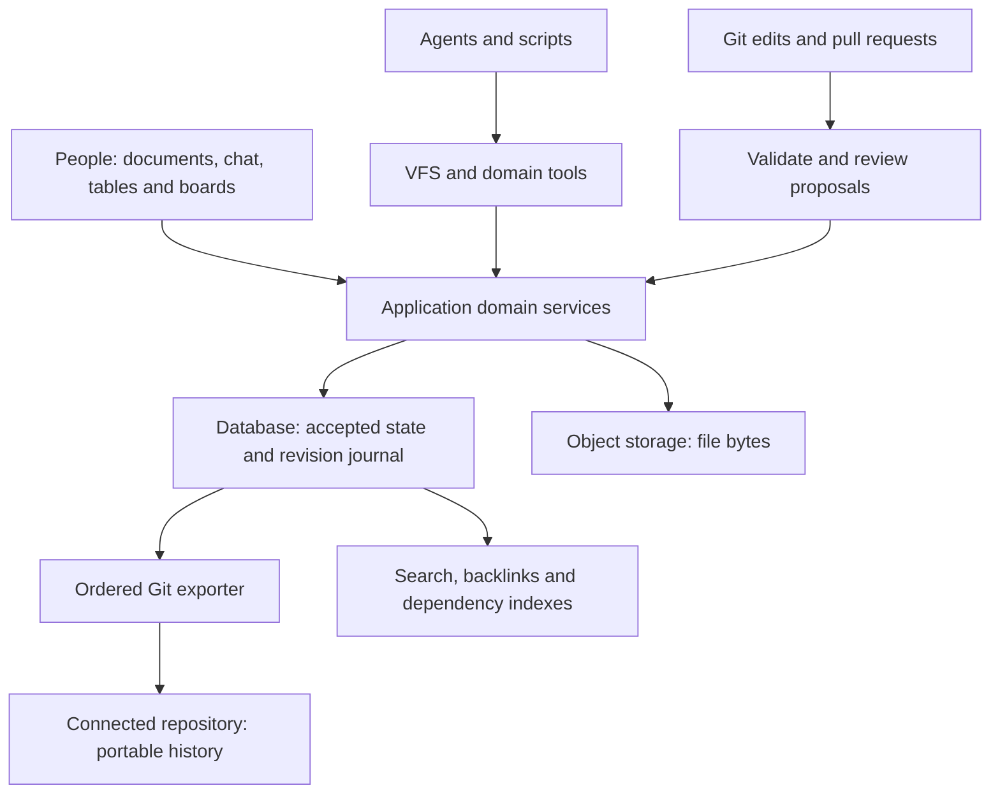
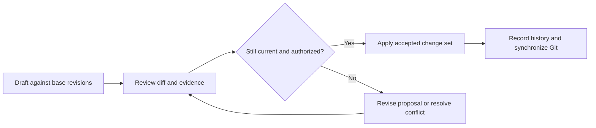

# Versioned Workspace: Master Overview

Status: Planning. Consolidates the user's accepted direction for a shared, versioned workspace and optional workspace-wide Git history. Architecture details and rollout phases below are proposals, not implementation claims.
Verified: 2026-09-12 against relevant local document, file, and VFS source and existing planning documents. No production, migration, provider, or end-to-end runtime verification was performed.

Reading guide:

- [Product idea and inspiration](#1-product-idea)
- [System architecture](#4-how-the-systems-fit-together) and [VFS](#5-vfs-as-the-common-agent-interface)
- [Revisions and proposed changes](#6-revisions-proposals-publication-and-history)
- [Workspace Git history](#7-git-history-for-the-whole-workspace) and [file storage](#8-object-storage-and-exact-file-history)
- [Connected knowledge](#9-connected-documents-evidence-and-reusable-sections) and [historical snapshots](#10-collection-snapshots-and-historical-questions)
- [Six practical workflows, starting with policy changes](#11-real-world-workflow-changing-a-company-policy)
- [Product interface and external editors](#17-what-this-would-look-like-in-the-product)
- [Current foundations](#18-current-foundations-and-implementation-gaps), [delivery sequence](#19-suggested-delivery-sequence-and-review-gates), and [open decisions](#20-remaining-design-decisions)

## 1. Product idea

OpenCompany becomes a workspace where humans and agents maintain company knowledge, work, operating instructions, and software together. Resources have stable identities, inspectable histories, reviewable proposed changes, and explicit relationships to their sources.

People continue using documents, chat, tables, boards, files, and agent conversations. Agents use domain tools and a permission-aware virtual filesystem over those same resources. A connected Git repository preserves portable workspace history. File contents live in S3-compatible storage, with their metadata and exact object references preserved in Git.

The resulting experience is concrete:

> Update our onboarding process using last week's decisions. Show the evidence, propose the related document changes, and preserve what we approved.

A user can inspect the original discussion, compare the proposed changes, accept the appropriate revisions, see which related material needs attention, and later recover the exact inputs used.

This takes inspiration from the read-write web, versioned resources, and connected documents. DeltaV includes version histories and collection baselines, which inform the resource and milestone concepts here. Implementing the full DeltaV protocol is a separate optional interoperability decision. [RFC 3253](https://www.rfc-editor.org/rfc/rfc3253)

The concepts raised in the discussion contribute different parts of the proposed experience:

| Inspiration | Application in this design |
|---|---|
| Read-write web | People can read and contribute through the same workspace interface. |
| WebDAV | Compatible external editors could access selected writable documents and files. |
| DeltaV | Addressable revisions, reviewable changes, and collections of particular resource versions. |
| Xanadu | Backlinks and transclusion inspire reusable sections that preserve a connection to their origin. |

These are product inspirations, not a claim of protocol compatibility or an attempt to reproduce each historical system. OpenCompany adds agent authorship, explicit evidence, domain operations, and optional Git-backed workspace history.

## 2. Agreed direction and proposed choices

| Topic | Direction |
|---|---|
| Shared workspace | Humans and agents work on the same durable resources through suitable interfaces. |
| Resource history | Documents and other durable workspace records retain addressable changes and provenance. |
| Agent collaboration | Agents can propose changes with evidence and identify affected resources. |
| Connected knowledge | Links, backlinks, exact-revision citations, and reusable sections connect resources. |
| Git connection | A workspace can connect to a repository containing its durable content, metadata, and history. |
| File contents | Workspace file bytes remain in object storage; metadata and exact blob references go into Git. |
| Live authority | Proposed: existing application domain services and database transactions own accepted application state. |
| Git synchronization | Proposed: a durable revision journal feeds an ordered Git exporter; imports enter validated proposal workflows. |
| Initial delivery | Proposed: consistent document revisions and review first, followed by progressively complete Git coverage and additional collaboration features. |

The workspace remains usable without a Git connection. An optional repository should enrich portability and collaboration without becoming an availability dependency for ordinary editing.

## 3. One resource, several useful views

A resource is an identifiable workspace object: a document, file, table row, agent instruction, task, message, automation definition, or future Artifact.

Each type retains its own domain rules while participating in common discovery, reference, history, and review conventions.

| View | What a user or agent sees |
|---|---|
| Web interface | A document editor, table, conversation, board, file preview, or Artifact. |
| Stable application link | A resource that remains addressable after renaming or moving. |
| VFS | A path with content or a structured projection, version metadata, and allowed operations. |
| Git | A deterministic serialization of the resource and its durable changes. |
| Historical view | A specific retained resource revision or a collection snapshot. |

For example, the same refund policy could appear as:

- A readable policy page in the Documents UI.
- A canonical VFS path such as `/docs/by-id/{document-id}`.
- A friendly VFS alias where supported.
- A proposed repository representation such as `docs/{document-id}/content.md` plus metadata.
- A citation pinned to revision 12.

An ordinary resource link follows its current state. A pinned citation identifies an exact retained revision. An approval or publication reference identifies a particular accepted or published state. Those meanings must remain distinguishable.

Human names are labels. Workspace identity and resource IDs determine ownership and durable references.

## 4. How the systems fit together



| Component | Owns | Important contract |
|---|---|---|
| Application domain services | Workspace scope, resource permissions, validation, revisions, approvals, and business transitions | Every mutation surface uses the appropriate domain operation. |
| Database | Live application state, durable revision journal, proposal state, and synchronization receipts | Accept a mutation and record its history atomically. |
| VFS | Permission-aware discovery, reads, projections, and supported edits | Expose the same resources and rules; declare read-only and writable capabilities truthfully. |
| Git | Portable serialized content and ordered history; external review and contribution | Preserve the recorded revisions and map commits to application change sets. |
| Object storage | File bytes and their retained historical versions | A retained file revision resolves to exact bytes with a verifiable checksum. |
| Search and relationship indexes | Searchable content, backlinks, embeddings, and dependency lookups | Rebuild from retained resources; check access before disclosing results. |
| Agent runtime | Runs, tool execution, evidence collection, and proposed work | Record attributable actions and explicit source references rather than inventing provenance afterward. |

The database and Git have different responsibilities. Git is an asynchronous portable representation of accepted history; it does not compete with the database to decide which live mutation is accepted. An external Git edit becomes an input to that same application authority.

A Git commit can identify a serialized workspace tree and its parent history. OpenCompany still needs domain schemas, revision identities, authorization, and import semantics to interpret that tree. [Git objects](https://git-scm.com/book/en/v2/Git-Internals-Git-Objects)

## 5. VFS as the common agent interface

The VFS gives agents a navigable view of company resources using familiar file and directory concepts. A table, message transcript, and document can all be discoverable without teaching an agent an unrelated discovery pattern for each screen.

Current mount families include:

```text
/
  docs/
  files/
  agents/
  tasks/
  lists/
  tables/
  channels/
  automations/
  approvals/
  tools/
  workspace/
```

`/artifacts` is a planned addition. Historical reads, cross-resource proposals, and pinned collection views are proposed extensions; their exact path and API grammar remains to be designed.

Existing primitive names include `vfs_ls`, `vfs_read`, `vfs_stat`, `vfs_patch`, `vfs_write`, and `vfs_exec`. The current [VFS runtime reference](../tools/vfs.md) owns their actual contracts.

A future policy-update workflow would use them conceptually as follows:

1. Discover the relevant documents and conversations within the agent's scope.
2. Read their contents and capture exact revision references.
3. Discover which target resources allow the required operation.
4. Prepare a proposal against the observed base revisions.
5. Show the proposed changes and evidence to the reviewer.
6. Apply accepted changes through their domain services after checking permissions and base revisions again.

Step 4 onward describes the proposed shared review layer, not an existing generic VFS proposal API.

File-like representation does not imply unrestricted file-like mutation. A generated channel transcript remains a view of messages; sending a message is a messaging operation. A table row patch must respect its schema. Changing a task status must respect its lifecycle. Agent identity and memory documents retain their dedicated permission boundaries.

The VFS and Git serializer can share resource identities and schema contracts, but a repository export must not be implemented by scraping an arbitrary agent's VFS view. Agent visibility, pagination, and read budgets would make such an export incomplete. A workspace export service needs explicit authorization and complete, domain-aware traversal.

## 6. Revisions, proposals, publication, and history

These concepts should remain distinct:

| Concept | Meaning |
|---|---|
| Resource revision | A retained state of one resource, including the metadata required to interpret it. |
| Proposal | Suggested changes, their base revisions, evidence, author, and review state. |
| Change set | A coherent group of accepted domain mutations with a stable identity. |
| Publication | A deliberate selection of an exact revision for an audience or running definition. |
| Execution | A run or external action using specific definitions and inputs. |
| Collection snapshot | A manifest selecting exact revisions across a defined collection. |

Suggested proposal lifecycle:



People can edit directly where policy permits. Agents can make routine authorized edits directly where appropriate. Review requirements depend on the resource and operation; there is no need to require a human to approve every message or spelling correction.

Every persisted workspace revision is part of the history contract. An editor may define deliberate save boundaries, but once a revision is accepted the Git exporter must not discard it by exporting only a later snapshot. A readable UI can group revisions without deleting the underlying history.

Acceptance must bind to the exact proposal and base revisions reviewed. Permissions and versions are rechecked within the mutation transaction using suitable concurrency control; an earlier version check by itself is insufficient.

An illustrative review card makes the workflow tangible:

```text
Proposed update: Customer onboarding
By Atlas · Based on revision 18

Changes
  Updated the account setup instructions
  Added the new escalation process

Evidence
  Operations discussion · September 11
  Support policy · revision 7

Related material
  Welcome email still describes the old process

[View changes]   [Request changes]   [Accept]
```

Acceptance records the exact resulting revision, evidence references, proposer, and reviewer. A conflicting edit changes the card's state to require renewed review. Publication or external delivery remains a separately identified step where the resource requires it.

One proposal may organize related work across several domains, but it must expose its application boundaries. A document-only change set could be one database transaction. Artifact definition change sets keep their existing planned scope. Sending email, provisioning accounts, and publishing to external systems remain separately tracked operations with explicit partial-failure outcomes.

Git attribution records authorship, not proof of authorization. OpenCompany's review and execution records establish who accepted and applied a change.

## 7. Git history for the whole workspace

The connection belongs at workspace level. The target coverage includes all durable workspace content and domain history: documents, agent configuration and memory, tasks, lists, tables and rows, calendar records, conversations, approvals, proposals, run records, automation definitions, future Artifacts, relationships, and file metadata.

This is broader than the existing plan for an individual Artifact's Git link.

Illustrative repository layout:

```text
workspace.json
members/
permissions/
docs/{id}/metadata.json
docs/{id}/content.md
docs/{id}/comments/
agents/{id}/profile.json
agents/{id}/identity/
agents/{id}/memory/
tasks/{id}.json
lists/{id}/
tables/{id}/schema.json
tables/{id}/rows/{row-id}.json
calendar/
channels/{id}/messages/{message-id}.json
conversations/{id}/messages/{message-id}.json
automations/{id}/
artifacts/{id}/
proposals/{id}/
approvals/{id}.json
runs/{id}/
links/
snapshots/{id}.json
files/{id}/metadata.json
history/{change-set-id}.json
```

This is a proposed storage format, not the current VFS tree or an implemented export schema. Use native authoring formats without lossy conversion: Markdown documents can use Markdown, while rich text may require HTML or editor JSON with an explicit format and schema version. Artifact source text is authored workspace content; uploaded and generated WorkspaceFile contents remain object-storage bytes, including text-file uploads.

Deterministic ordering, stable paths, explicit schema versions, and small resource files make history easier to review. Resource IDs preserve relationships through renames. Deleted resources disappear from the current representation, with deletion events and earlier states retained according to the history policy.

### Write and synchronization sequence

1. If the operation includes file bytes, store and verify immutable candidate objects first.
2. Authorize and validate the operation against current resource revisions.
3. In one database transaction, update the domain records and persist the exact revision payloads and history/export event.
4. Assign a stable change-set identity and ordered workspace sequence.
5. A serialized exporter applies those recorded payloads to the previous exported tree and creates the commit.
6. Record the commit mapping and push status in the synchronization ledger.
7. Push normally and retry transient failures without creating duplicate logical history.

The exporter must not reconstruct revision 12 from a database row that has already advanced to revision 15. It consumes retained payloads or immutable revision references.

Record commit IDs after commit creation in the synchronization ledger; do not require a commit to contain its own hash. A stable change-set ID in committed metadata supports reconciliation after a crash between commit creation and receipt recording.

Remote divergence pauses that export stream for reconciliation. The exporter must not overwrite unrelated repository work or force-push away history. A managed branch or namespace, stable repository identity, and explicit ownership keep imports and exports from creating loops. Git transport can support hosted or self-hosted remotes without coupling the core model to one hosting provider.

Application state and remote push are not one distributed transaction. Users see saved state and the synchronization backlog separately. A publishing policy may require remote synchronization for a particular release, but ordinary editing can continue during a Git outage.

Connecting a repository starts with a consistent baseline and a journal cutoff so concurrent writes are captured afterward. Earlier history can only be backfilled where OpenCompany actually retained it. Connection must disclose that boundary instead of fabricating a complete pre-connection past.

### External editing

Outbound history is the first useful delivery. Later, compatible repository edits can become proposals in OpenCompany.

The importer checks the exact source commit, mapped base revisions, resource schema, references, and permissions. It presents domain-aware changes and routes acceptance through the owning services. Git merge success does not prove that a task transition, permission change, table migration, or publication is valid.

Run receipts, past messages, and approval decisions are historical records. Arbitrary changes to their serialized files must not forge past execution or authorization; any supported correction needs its own recorded domain operation.

An Artifact can also have a dedicated development repository. Its specific source authority must be declared: the workspace history repository can record the accepted Artifact state without becoming a second independent source publisher. The [Artifact plan](automation-endpoints-artifacts.md) continues to own bundle import, publication, binding, and template rules.

### Coverage, access, and growth

Credentials, tokens, session state, cache entries, and transient process state remain outside the export. Durable resource serializers need an explicit secret-handling and redaction policy. Record coverage and permitted omissions in the export manifest; never describe a partial export as complete workspace history.

A full-workspace repository is an export permission boundary. Anyone who can read its history can read the exported content. Application document ACLs cannot restrict a clone. Teams needing narrower access can use explicitly scoped repositories, whose coverage is visibly partial. Artifact templates remain portable source packages and do not inherit private workspace histories.

Redacting a current file does not erase its older Git objects or existing clones. Deliberate historical erasure needs explicit repository-history handling and cannot retract copies already obtained by other readers.

Git history does not itself prevent an authorized repository owner from rewriting or deleting it. It should not be described as tamper-proof storage.

Measure sustained message and row churn, commit throughput, repository growth, clone duration, and restore duration. Push batching, serialized workers, bounded files, and directory sharding can improve operations while retaining every captured revision. If measured scale requires a different archival representation, make that an explicit product decision instead of silently dropping history.

## 8. Object storage and exact file history

Git records which file existed, its meaning, and which bytes belonged to each retained revision. S3-compatible storage holds those bytes.

Illustrative metadata:

```json
{
  "schema_version": 1,
  "id": "file_example",
  "name": "customer-proposal.pdf",
  "parent_id": "folder_proposals",
  "owner_id": "agent_sales",
  "mime_type": "application/pdf",
  "size": 184320,
  "content_sha256": "<sha256-of-exact-bytes>",
  "storage": {
    "binding": "workspace-assets",
    "object_key": "blobs/<content-id>",
    "version_id": "<object-version-if-supported>"
  },
  "generated_from_snapshot": "snapshot_proposal_example"
}
```

The storage binding is a portable name resolved to a workspace storage configuration. It contains no access key or expiring download URL.

Prefer immutable object keys and verified content digests. Where supported and enabled, a provider's version ID can identify the exact retained object version. S3 Versioning preserves distinct object versions and permits retrieval by version ID; permanent deletion of a version still removes those bytes. [S3 versioning](https://docs.aws.amazon.com/AmazonS3/latest/userguide/versioning-workflows.html)

| Operation | Object storage | Git history |
|---|---|---|
| Rename or move a file | Reuse the same bytes | Change name or parent metadata |
| Replace its contents | Write a new immutable object/version | Record a new checksum and object reference |
| Remove from the current workspace | Retain bytes while historical references require them | Record deletion and preserve earlier metadata |
| Restore an earlier file version | Resolve and verify retained old bytes | Create a new current revision referencing them |
| Remove historical bytes under an explicit retention operation | Delete selected retained objects | Historical inspection reports unavailable bytes where relevant |

Upload completion precedes acceptance of metadata that promises available bytes. Failed database transactions can leave unreferenced candidate objects, which a later cleanup process can remove. Garbage collection must consider retained snapshots, proposals, and published versions before deleting objects.

A Git checkout alone is insufficient to recover file contents. Restoring recorded workspace content needs the repository, retained blobs, supported schemas, and import tooling. Credentials and external connections must be rebound.

## 9. Connected documents, evidence, and reusable sections

There are three useful relationship types:

| Relationship | Behaviour |
|---|---|
| Link or citation | Navigate to a resource, optionally pinned to an exact revision and section. |
| Embedded section | Render a referenced passage, following an approved head or a pinned revision. |
| Derivation | Record that an output was prepared using particular inputs. |

For example, the support handbook can embed the current approved refund rules, while a sent customer proposal cites the exact revision used on its preparation date.

Backlinks answer where a resource is referenced. Dependency tracking answers which outputs may need review after it changes. A source change marks derived work as potentially stale; it does not prove that the output is incorrect or authorize an automatic rewrite.

Stable section identities, source revision IDs, and explicit embed policy prevent references from silently jumping to unrelated text after edits. Missing or inaccessible sources must be represented clearly. Historical reads, search snippets, and backlink counts must respect current access rules; restoring content does not restore revoked permissions.

Agent-created relationships should be grounded in actual reads and recorded citations. A run can record observed inputs and outputs; it cannot prove every aspect of a model's internal reasoning.

Refreshing derived work needs an explicit trigger, subscription, schedule, or task. The future dependency layer does not imply that every agent continuously watches the whole company.

## 10. Collection snapshots and historical questions

A collection snapshot selects exact revisions of a defined resource set:

```text
September operating review
  strategy document: revision 14
  staffing plan: revision 6
  metrics table: captured rows at workspace sequence 4821
  agent instructions: revision 9
  generated PDF: file revision 3
```

It can answer what the report used and which material was approved together. It must identify its coverage: a selected project snapshot is not a snapshot of every workspace resource.

For local database data, use a consistent read or a reconstructable revision cutoff. Paging live tables while they change does not produce a strict historical snapshot. External observations carry capture timestamps and source versions where available; they do not imply a single atomic moment across unrelated external services.

History distinguishes when OpenCompany recorded something from when it became effective in the business. A price recorded on September 12 but effective October 1 needs both concepts. Git commit time alone cannot answer which price applied to a customer.

Restoring content creates new current history. Historical inspection of a run remains read-only. Re-running a past workflow is a new execution with current authorization and explicit handling of side effects. Recorded inputs support explanation and comparison, not a guarantee of identical AI output.

## 11. Real-world workflow: changing a company policy

An operations lead says:

> We changed the escalation process in yesterday's meeting. Update the handbook and onboarding guide, and show what else is affected.

The agent reads the relevant conversation, existing escalation policy, handbook, and onboarding guide through its authorized VFS and domain tools. It records exact source revisions and distinguishes an actual approved decision from an unresolved discussion.

It prepares a proposal showing the policy change, the guide edits, evidence links, and affected material. An existing handbook embed can follow the newly approved policy revision. A separately written welcome email is marked for review and gets its own suggested rewrite.

The reviewer accepts the appropriate document changes. Their revisions and accepted change set are recorded in the database and exported to Git. If the team wants to announce the policy, sending that announcement is a separately authorized messaging action with a delivery record.

Later, someone can inspect the prior wording, the discussion that motivated the change, the reviewer, and the exact revision used during a particular onboarding.

Practical value: policy updates become traceable maintenance work, and related documents stop depending entirely on someone remembering every copy.

## 12. Real-world workflow: preparing a customer proposal

A salesperson asks:

> Prepare a proposal for the customer using their requirements, our approved pricing, and the standard service description.

The agent reads a customer table row, requirements document, approved pricing revision, and reusable service sections. It creates a proposal draft with a manifest of those inputs.

The salesperson reviews the content and pricing assumptions. A PDF is generated and stored as a versioned workspace file. Git contains the source content, input references, file metadata, review decision, and subsequent recorded workflow events. The PDF bytes remain in object storage.

If the pricing policy changes a week later, the sent proposal keeps its pinned pricing reference. A new draft can use the new pricing. Sending either proposal remains an explicit external action.

Practical value: the team can explain exactly what it offered and retrieve the corresponding document without relying on the current pricing page or a mutable file URL.

## 13. Real-world workflow: producing a monthly management report

A manager asks:

> Produce the monthly operating report and explain changes from last month.

The agent captures the defined table rows, task records, and strategy documents at a consistent local revision boundary. External data is captured with its own observation time and provenance. It compares this month's captured inputs with last month's retained snapshot.

The report includes exact source references. Charts, exports, and the published PDF have file metadata pointing to their stored bytes. Review and publication choose exact revisions, and Git preserves the recorded state and changes.

If an input is corrected later, the team can publish an amended report while retaining the original and a clear correction history.

Practical value: monthly reports remain explainable even as live tables and dashboards continue changing.

## 14. Real-world workflow: improving an agent's instructions

A support lead observes:

> The agent escalates routine account changes too often. Here are three examples of the correct handling.

The agent or lead proposes a scoped instruction change grounded in those examples. The proposal includes the affected instruction revision, expected behaviour, and a preview or evaluation appropriate to the change.

Acceptance creates a new instruction revision through the dedicated agent configuration boundary. Future runs record the instruction revisions they actually loaded. Earlier run records continue pointing to their original inputs.

If the change performs poorly, restoring the previous instructions creates another revision. It does not erase the intervening run history or replay those actions.

Practical value: improving an agent becomes a reviewable operating change with evidence and recoverable configuration.

## 15. Real-world workflow: developing an internal tool through Git

A team asks:

> Build an internal onboarding tracker from our existing customer table.

Under the future Artifact model, an agent prepares source, interface assets, tests, and a binding requirement for the customer table. A developer can review or edit compatible source in Git and submit a pull request.

OpenCompany imports the specific commit as a draft proposal, validates its schema and binding changes, and uses the Artifact's publication workflow to produce an exact published version. The live application accesses canonical table data through permission-checked domain services.

The workspace history repository records the accepted source and publication history. A separate development repository can own the Artifact's source workflow if configured explicitly. Customer rows and private workspace history do not become part of a reusable Artifact template.

Practical value: nontechnical users, agents, and developers can collaborate on the same internal tool while keeping source review, workspace data, and execution responsibilities clear.

## 16. Real-world workflow: moving or inspecting a workspace

An operator connects the workspace history repository and retained object archive to a new OpenCompany installation.

A future restore tool validates the export schema, resolves resource references, verifies blob checksums, reports missing objects and redacted fields, and reconstructs the recorded content and history. Credentials are supplied separately. Restored automations start inactive until explicitly reactivated; importing historical run records never enqueues those runs.

A narrower use is an inspection-only historical view of a project milestone. It can show old documents, rows, and reports without changing the live workspace.

A scenario branch can contain proposed future documents, definitions, or table edits. It does not automatically create an independently running company with cloned accounts, external services, and schedules.

Practical value: inspectability, portability, and recovery become deliberate product features. Full disaster recovery remains broader than a Git clone and requires tested database, object, configuration, and credential recovery procedures.

## 17. What this would look like in the product

The existing resource screens remain the primary places to work. Shared controls make history and proposed work discoverable:

| Surface | Proposed experience |
|---|---|
| Document or resource header | Current revision, author, publication state, and history access |
| History panel | Readable revisions, diffs, source links, review attribution, and restore where supported |
| Proposal inbox | Agent and human proposals with exact bases, evidence, related changes, and conflicts |
| References panel | Backlinks, embedded sections, pinned citations, and potentially stale derived work |
| Agent run view | Instruction and input revisions, outputs, actions, and execution receipts |
| Project snapshot view | Defined collection coverage and its exact selected revisions |
| Workspace Git settings | Repository, managed branch/path, coverage, synchronized sequence, backlog, and conflicts |
| File details | Current content version, previous versions, checksums, and availability |

Users should be able to review revisions and proposals without understanding Git terminology. Git commit and branch details remain available when useful for development, history inspection, or synchronization troubleshooting.

Synchronization labels should distinguish `Saved locally`, `Awaiting Git sync`, `Synced`, and `Sync needs attention`. A successful application save must not imply that the remote repository has already received it.

### Optional external editors

A future WebDAV adapter could expose selected document and file collections to compatible desktop clients. A person could open a supported document in an external editor, save it through OpenCompany's domain services, and see the resulting revision in the web interface and Git history.

Client compatibility, content-format round trips, conflict detection, and any locking behaviour need explicit qualification. An external editor receives only its authorized resource scope and cannot bypass version checks, review requirements, or publication rules. Rich-text authoring formats must survive a round trip without silent conversion loss.

WebDAV would be another access interface over the shared resource model. Full DeltaV support is a separate future decision; the internal revision, evidence, snapshot, and Git features do not depend on it.

## 18. Current foundations and implementation gaps

These are local source observations, not claims about production or complete runtime correctness.

| Area | Existing foundation | Work required for this proposal |
|---|---|---|
| Documents | [DocumentVersion](../../app/Models/DocumentVersion.php), [version controller](../../app/Http/Controllers/Api/DocumentVersionController.php), and [diff UI](../../resources/js/Components/docs/DocumentDiffViewer.vue) | Consistent revision capture, complete metadata, immutable revision addresses, concurrency-safe writes, and shared proposal workflow |
| Document writes | [Direct agent updates](../../app/Agents/Tools/Docs/UpdateDocument.php) optionally snapshot; [VFS document edits](../../app/Domain/Vfs/OpenCompany/Concerns/MutatesVfsDocuments.php) snapshot changed content | A common contract across all write paths, including human APIs, imports, background work, and restoration |
| Version checks | VFS accepts version tokens; [assertVersion](../../app/Domain/Vfs/OpenCompany/Concerns/PatchesVfsRecords.php) skips comparison when no token is supplied | Required base checks where appropriate, inside atomic mutation/concurrency control |
| VFS | [OpenCompanyVfs](../../app/Domain/Vfs/OpenCompany/OpenCompanyVfs.php), [VfsEntry](../../app/Domain/Vfs/Core/VfsEntry.php), mount adapters, capabilities, pagination, and permission handling | Historical resource reads, snapshot views, and integration with proposed shared revisions and review |
| Files | [WorkspaceFile](../../app/Models/WorkspaceFile.php) separates metadata from storage-backed bytes | A uniform immutable blob identity, checksum, retention, and restore contract |
| Runs and approvals | [AgentRunRecord](../../app/Models/AgentRunRecord.php), [AgentToolExecution](../../app/Models/AgentToolExecution.php), and existing approval flows | Consistent input-revision manifests and exact proposal/change-set/commit correlation |
| Git | Existing [Artifact Git plan](automation-endpoints-artifacts.md#git-integration) | Workspace-level connection, export schema, complete revision journal, reliable synchronization, and validated import |
| Connected knowledge | Documents, comments, links in authored content, and search foundations | Structured backlinks, section identities, transclusion, dependency invalidation, and revision-aware citations |
| Artifacts | Detailed [Artifact plan](automation-endpoints-artifacts.md) | First-class Artifact implementation, publication, and its VFS projection |
| Authorization | Workspace isolation and agent-side permission foundations | Complete human resource enforcement and equivalent checks for history, search, imports, exports, and embeds |

The version helper and snapshot calls alone do not establish an immutable, atomic history system. Current human document authorization gaps also remain relevant when designing historical views and export capabilities; see the [current-state inventory](../CURRENT_STATE.md).

## 19. Suggested delivery sequence and review gates

| Stage | Deliverable | Evidence needed before describing it as complete |
|---|---|---|
| 1. Resource revision foundation | Consistent document revisions, metadata, restore-as-new-revision, and permission checks | Every supported document mutation path records history; concurrent edits cannot silently overwrite reviewed bases |
| 2. First complete vertical slice | One document proposal with evidence, exact acceptance, Git history, and file metadata references | Human and agent changes round-trip; interrupted export retries preserve each captured revision |
| 3. Workspace Git coverage | Domain serializers and journal coverage for all durable resource families | An explicit coverage manifest and change/restore checks for each family; partial scope remains labeled partial |
| 4. Connected knowledge | Pinned citations, backlinks, reusable sections, and dependency review | References survive renames; source drift and revoked access are handled correctly |
| 5. Historical collections | Consistent snapshots and run input manifests | Captured rows remain stable under concurrent edits; missing historical bytes are reported truthfully |
| 6. External contribution | Git imports and pull requests for supported editable resources | Schema and domain validation, conflict handling, exact commit review, and no import-triggered replay of past effects |
| 7. Broader interoperability | Restore/migration tools, optional WebDAV, and additional repository workflows | Representative recovery exercises, client compatibility checks, and measured scale limits |

Git integration should be designed with the revision foundation, so it does not depend on an after-the-fact database scraper. Early delivery can cover documents first, but that is an explicit vertical slice of the user's workspace-wide requirement.

The first product demonstration should complete this chain:

> Ask an agent to update a policy from cited decisions; review and accept the diff; see the new revision in OpenCompany and Git; inspect the prior revision; retrieve an attached file's exact prior bytes; identify a dependent guide needing review.

## 20. Remaining design decisions

The accepted direction leaves implementation choices to resolve with the first detailed specification:

- The canonical rich-text representation and schema migration contract.
- Draft/autosave revision boundaries and UI grouping without discarding persisted history.
- Whether proposal content uses dedicated Git branches or serialized proposal records initially.
- Managed branch/path ownership and the relationship to optional Artifact development repositories.
- Exact resource and section reference syntax across web links, VFS, Git, and citations.
- History retention, explicit redaction, and behaviour when retained file bytes become unavailable.
- Event-volume and repository-size limits, plus visible failure/backpressure behaviour.
- Snapshot consistency across local resources and separately captured external observations.
- The initial resource-family coverage and the remaining gates to full workspace export.

These choices should be decided explicitly. They do not change the central model: shared resources, inspectable revisions, agent proposals with evidence, optional complete Git history, and object storage for file bytes.

## Related documents

- [Documentation policy](../README.md)
- [Current implementation inventory](../CURRENT_STATE.md)
- [Roadmap and open audits](../ROADMAP.md)
- [Current VFS runtime contract](../tools/vfs.md)
- [Unified VFS architecture](unified-vfs-overview.md)
- [Automation endpoints and agent-built Artifacts](automation-endpoints-artifacts.md)
- [Agent run queue control plane](../architecture/agent-run-queue-control-plane.md)
- [Optional Bowerbird durable automation integration](../architecture/bowerbird-durable-automation-integration.md)

This document owns the combined workspace concept. Existing runtime references own current behaviour, the Artifact plan owns its domain-specific contracts, and the Bowerbird plan owns optional cross-product execution boundaries. No additional runtime dependency is implied by this overview.
